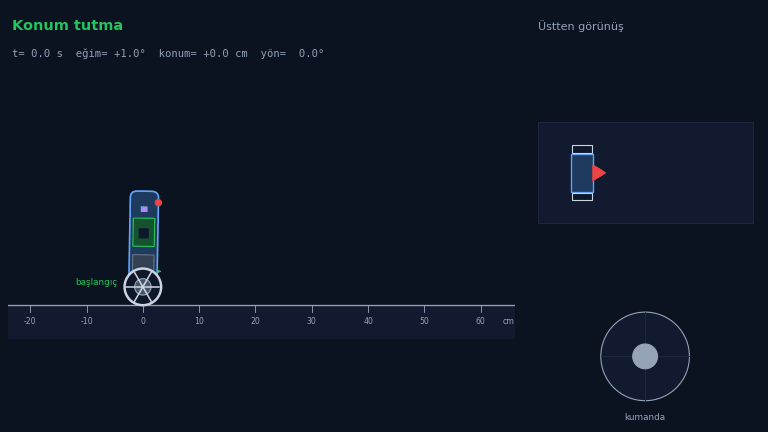
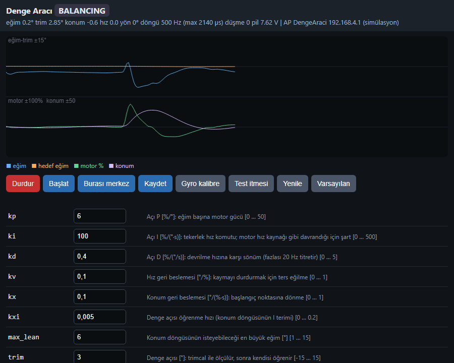
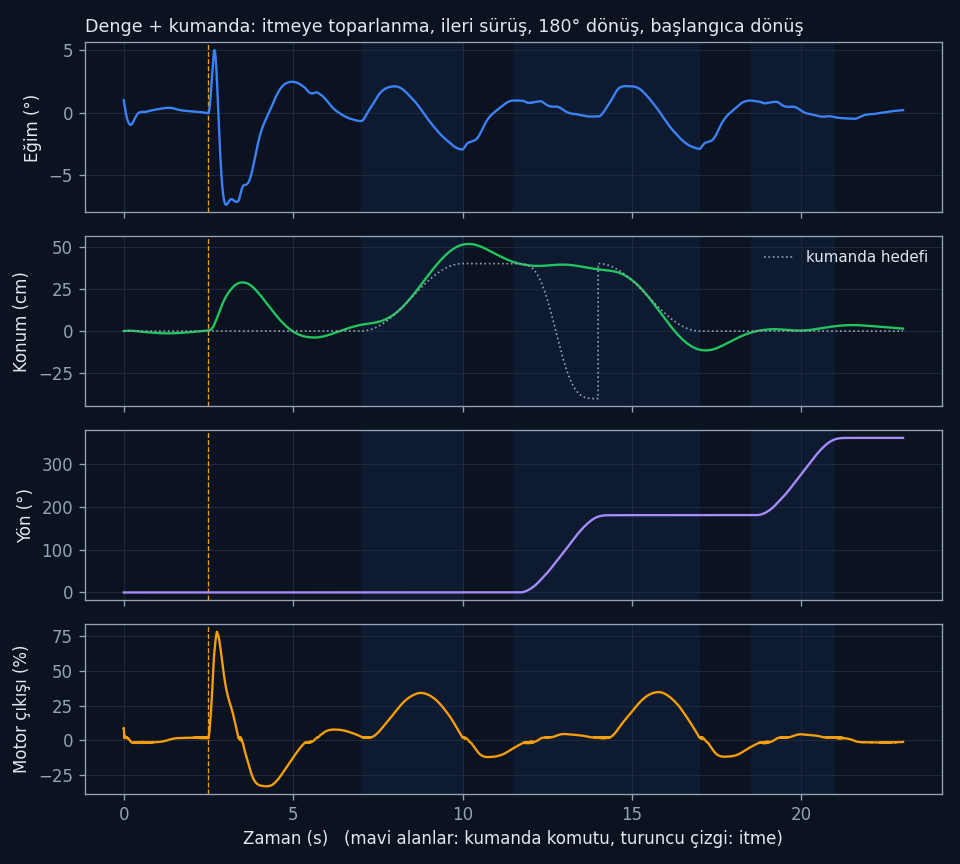

<div align="center">

# ⚖️ ESP32 İki Tekerlekli Denge Aracı

**İki tekerlekli aracı hem dengede hem yerinde tutan, kumandayla sürülebilen ESP32-C3 firmware'i: 500 Hz FreeRTOS kontrol döngüsü, kaskad PID, enkodersiz konum ve yön tutma, kendi kendine ayağa kalkma, telefondan canlı ayar arayüzü**




<sub>Fizik simülasyonu, firmware'deki kontrol yasasıyla: araç yerinde dururken 0,4 m/s'lik bir darbeyle itiliyor, devrilmeden toparlanıp başladığı noktaya dönüyor; sonra kumandayla 40 cm ileri gidiyor, yerinde 180° dönüyor, geri gelip başladığı yerde ve aynı yönde duruyor.</sub>

</div>

## Proje hakkında
İki tekerlekli, enkodersiz ve ucuz DC motorlu bir aracın firmware'ini sıfırdan yazdım. Araç tek aks üzerinde duruyor; devrilmemek için tekerleklerini sürekli gövdenin altına doğru sürüyor. Hedefler şunlardı:
- dengede kalmak ve itildiğinde toparlanmak,
- kendi haline bırakıldığında **başladığı yerde ve aynı yönde durmak** (konum + yön tutma),
- kumandayla ileri/geri sürülebilmek ve yerinde dönebilmek; komut bitince yeni yerinde aynı şekilde durmak.

Sürüş, denetleyicinin konum/hız hedefini kaydırarak, dönüş ise yön tutma hedefini değiştirerek yapılıyor; denge döngüsü her durumda devrede kalıyor. Aracın ilk sürümünü Unity ile yazdığım bir kumanda uygulamasıyla (klavye → Wi-Fi/TCP) sürüyordum.

Enkoder olmadığı için konum doğrudan ölçülemiyor. Bunun yerine motor komutundan hız ve konum tahmin edip dış döngüde kullandım.

Denetleyiciyi gerçek robota yüklemeden önce bir **fizik simülasyonunda** (iki tekerlekli aracın gövde + tekerlek dinamiği ve DC motor modeli) doğruladım. Simülasyondaki denetleyici, firmware'deki kontrol yasasının birebir Python karşılığıdır.

## Özellikler
- **500 Hz kontrol döngüsü:** Yüksek öncelikli bir FreeRTOS görevi olarak çalışır. Döngü süresi ve en kötü durum gecikmesi (`dt_max`) sürekli izlenir.
- **IMU:** MPU6500 için register seviyesinde sürücü (DMP kullanılmadan).
  - Açılışta gyro bias kalibrasyonu yapılır.
  - Eğim, tamamlayıcı filtre ile hesaplanır.
  - Montaj yönü yerçekiminden otomatik öğrenilir.
- **Kaskad kontrol**
  - İç döngü: açı **PID**'i. DC motor hız kaynağı gibi davrandığı için I terimi şarttır; bunu simülasyonda gösterdim.
  - Dış döngü: tahmini hız ve konum geri beslemesi. Hedef eğim `trim − kx·x − kv·v` olarak hesaplanır.
  - Denge açısı (trim), konumun integraliyle **kendiliğinden öğrenilir**.
  - Yön tutma: gyro-z integraliyle. İşaret yanlışsa kendini güvenli şekilde kapatır.
- **Kendi kendine kalkma:** Robot yatıyorsa önce geri sonra ileri bir hamleyle kendini dikleştirir, ardından denge devralır.
- **Motor sürüşü:** 20 kHz LEDC PWM, ölü bölge telafisi, frenli (slow-decay) PWM ile daha doğrusal hız.
- **Kalıcı parametreler:** 25'ten fazla parametre NVS (flash) içinde saklanır. Flash yazımı CPU'yu durdurduğu için denge sırasında ertelenir.
- **Üç ayrı arayüz, tek komut ayrıştırıcı:** USB seri, UDP ve web aynı komutları kullanır.
- **Telefondan ayar:** Robot kendi Wi-Fi erişim noktasını açar. Tarayıcıdan canlı grafik, parametre düzenleme ve test itmesi yapılabilir.



## Mimari
```mermaid
flowchart LR
    IMU[MPU6500<br>I2C 400 kHz] --> F[Tamamlayıcı filtre<br>eğim + eğim hızı]
    F --> A[Açı PID<br>iç döngü]
    E[Hız/konum tahmini<br>LPF(u) · ∫v] --> O[Dış döngü<br>hedef eğim]
    O --> A
    A --> M[Ölü bölge telafisi<br>20 kHz PWM] --> MOT[2 × DC motor]
    A -. u .-> E
    subgraph Ağ
        W[Web arayüzü] --> CMD[Komut ayrıştırıcı]
        U[UDP / Seri] --> CMD
    end
    CMD --> P[(NVS parametreler)]
    P --> A & O
```

## Simülasyon


```bash
cd simulation
python sim_balance.py   # 3 farklı robot modeli × 3 itme senaryosu, hepsi OK olmalı
python animate.py       # denge + kumanda senaryosu: push_recovery.gif + push_recovery.png (matplotlib)
python web_demo.py      # web arayüzünü simüle edilmiş telemetriyle açar → http://127.0.0.1:8080
```

## Nasıl denenir
- **Donanımsız:** `simulation/web_demo.py` ile robotun gerçek ayar arayüzünü tarayıcıda açabilirsin. Grafikler fizik simülasyonundan beslenir.
- **Donanımla:** ESP32-C3 Super Mini, MPU6500/6050, DRV8833 tipi sürücü ve iki redüktörlü DC motor gerekir. Firmware'in tamamı paylaşılmamıştır.

## Kod örnekleri
- [`firmware/Control.ino`](firmware/Control.ino): 500 Hz görev, durum makinesi, kaskad denetleyici, kendi kendine kalkma.
- [`firmware/Imu.ino`](firmware/Imu.ino): register seviyesinde IMU sürücüsü, kalibrasyon, tamamlayıcı filtre.
- [`firmware/Motors.ino`](firmware/Motors.ino): LEDC PWM, ölü bölge ve slow-decay sürüş.
- [`firmware/Params.ino`](firmware/Params.ino): parametre tablosu ve NVS kalıcılığı.
- [`simulation/sim_balance.py`](simulation/sim_balance.py): Lagrange denklemleriyle iki tekerlekli araç simülasyonu (kumanda hedefi girişiyle).

## Neler öğrendim
- Kontrol tasarımını önce simülasyonda doğrulayıp sonra donanıma taşımak.
- Gerçek zamanlı bir görevi (500 Hz) ağ, flash ve web sunucusuyla aynı tek çekirdekte bozulmadan çalıştırmak.
- Sensörü eksik bir sistemde (enkodersiz) durum tahmini yapmak.

---
<sub>© Ahmet Emin Arslanbaş — Tüm hakları saklıdır. Kod inceleme amaçlı paylaşılmıştır.</sub>
